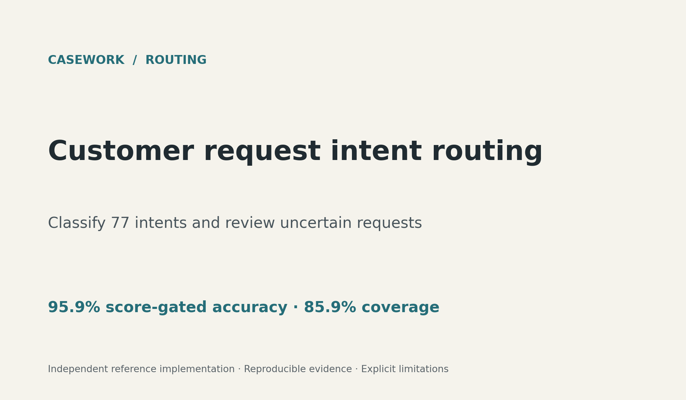

# Casework — Applied Data & AI Systems

Five independent business workflows: reconciling inconsistent records, ingesting signed events, prioritizing retention outreach, estimating hourly demand, and routing customer requests. Each workflow has a bounded problem, reusable Python implementation, audit artifacts and explicit limitations.



These are independent reference implementations using public benchmark data and synthetic examples. They do not represent paid client engagements or measured business savings.

## Projects

| Project | Problem | Evidence and deliverables |
|---|---|---|
| [Record reconciliation](projects/01-record-reconciliation/README.md) | Merge exports without a reliable shared identifier | Candidate evidence, conservative rules, ambiguity queue, collision protection, order-preserving CSV and hash audit |
| [Signed event ingestion](projects/02-event-ingestion/README.md) | Duplicate or conflicting webhooks corrupt analytics | HMAC validation, freshness window, idempotent receipt, transactional outbox, integer money accounting and replay demonstration |
| [Retention prioritization](projects/03-retention/README.md) | A team can only contact a limited share of customers | Baseline comparison, validation-selected threshold, PR-AUC, lift at 20%, calibration audit and scoring API |
| [Hourly demand estimation](projects/04-demand/README.md) | Staffing/fleet planning needs estimates and error bounds | Future-period holdout, rolling checks, hourly error slices, baseline comparison and empirical interval coverage |
| [Customer request routing](projects/05-request-routing/README.md) | Similar customer questions need reliable categorization | 77 intents, deduplicated holdout, validation-selected review gate, partial redaction, reference retrieval and structured API |

## Reproduce

Run commands from this directory. Python 3.11+; the checked run uses the versions in `requirements-lock.txt` and `artifacts/verification.json`.

```powershell
python -m venv .venv
.venv\Scripts\Activate.ps1
python -m pip install -r requirements-lock.txt
python -m pip install -e . --no-deps
python scripts/fetch_data.py
python scripts/run_all.py
python -m pytest -q
python scripts/build_reports.py
```

`fetch_data.py` downloads only public data files and license text. `data/sources.json` freezes repository commits and content hashes; subsequent downloads verify the hashes before saving. The raw manifest records the same provenance. No private client rows are included.

Run a custom record merge with `python -m casework reconcile --left source_a.csv --right source_b.csv --out result`. Both inputs must satisfy the documented example schema. `python -m casework worker --db events.sqlite` processes pending webhook records. `python -m casework train retention` trains one model workflow.

The reconciliation package also includes a controlled benchmark with 2,070 source records and 820 enrichment records. The ground-truth fixture deliberately includes duplicate emails, shared network metadata, conflicting addresses and invalid dates. Its zero false automatic links are an edge-case check, not a real-world accuracy estimate.

Start the local scoring service after training:

```powershell
$env:MODEL_API_KEY = 'replace-with-a-local-key'
python -m casework.serve
```

POST `/predict/retention` with `{"records": [...]}`, `/route` with `{"text": "My card has not arrived"}`, or `/tickets` with `{"ticket_id":"T001","text":"My card has not arrived"}` and `X-API-Key`. Ticket receipt stores the result once, returns it for duplicate IDs and rejects conflicting reuse. Each endpoint rejects invalid contracts rather than silently altering request fields. The service binds to localhost; real deployment needs TLS, rate limiting, secrets management, monitoring and approved data handling.

Start webhook receipt separately:

```powershell
$env:WEBHOOK_SECRET = 'replace-with-a-local-key'
$env:WEBHOOK_DB = 'events.sqlite'
python -m casework.ingestion
```

For a container image, regenerate the models with `python scripts/run_all.py` before running `docker build -t casework .`. Generated model binaries are excluded from Git and must exist locally when the image is built. Run with `docker run --rm -p 127.0.0.1:5051:5051 -e MODEL_API_KEY casework` after setting the key in the shell. The container configuration is provided as a deployment starting point; the local verification did not include a running Docker engine.

The signed input contract and worker instructions are in the ingestion project. Model persistence uses locally generated joblib files; do not load untrusted model artifacts. See [scikit-learn's persistence guidance](https://scikit-learn.org/stable/model_persistence.html).

## Data and attribution

- Retention: [IBM Telco Customer Churn reference data](https://github.com/IBM/telco-customer-churn-on-icp4d), Apache-2.0 repository. Dataset is a public demonstration, not independently verified live customer history. License text retained by the fetcher.
- Demand: [UCI Bike Sharing](https://archive.ics.uci.edu/dataset/275/bike+sharing+dataset), Hadi Fanaee-T, 2013, DOI `10.24432/C5W894`, CC BY 4.0. Derived features and split periods are documented. Dataset includes 2011–2012 Capital Bikeshare rental counts.
- Routing: [PolyAI BANKING77](https://github.com/PolyAI-LDN/task-specific-datasets), CC BY 4.0. Casanueva et al. (2020), [Efficient Intent Detection with Dual Sentence Encoders](https://arxiv.org/abs/2003.04807). This implementation uses TF-IDF and logistic regression, not the paper's encoder. Texts are normalized/redacted, duplicate conflicts removed and train/test overlaps excluded.
- Reconciliation and ingestion: fabricated non-personal examples with reserved `example.test` addresses and documentation IP ranges. They demonstrate edge cases rather than estimate real-world accuracy.

## What to inspect

Open `reports/index.html` for measured case summaries, `notebooks/` for executable walkthroughs, `artifacts/` for CSV/JSON/PNG evidence, and `tests/` for failure cases. No transformers, paid LLM service, cloud infrastructure or external CRM is required. The scope deliberately stays at reproducible small-to-medium Python systems; multilingual NLP, production MLOps and LLM agent engineering are separate capabilities requiring their own evidence.
